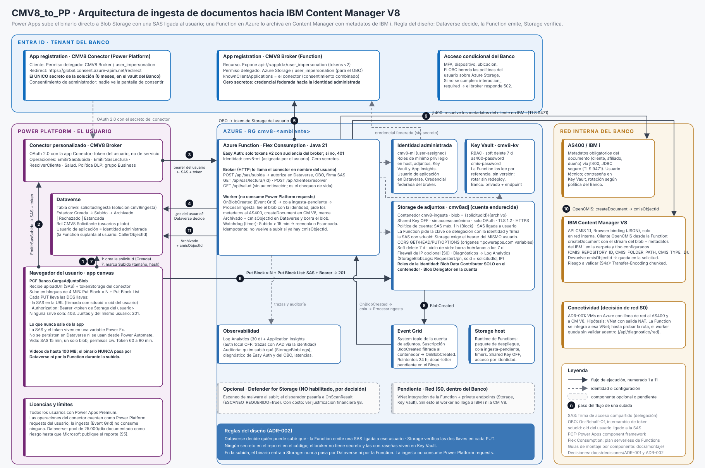

# Arquitectura de la solución

Cómo funciona CMV8_to_PP de punta a punta: qué componente hace qué, en qué orden, y por qué cada uno está. El diagrama es `docs/diagramas/arquitectura.svg` (se regenera con `python3 docs/diagramas/generar-arquitectura.py > docs/diagramas/arquitectura.svg`). Las decisiones que lo sostienen son ADR-001 (conectividad) y ADR-002 (Blob para binarios), en `docs/decisiones/`. El montaje de cada componente, con Bicep, CLI y portal, está en `docs/montaje/`.

## La idea en tres frases

1. **Dataverse decide.** La solicitud de ingesta es una fila de `cmv8_solicitudingesta`; quién puede subir qué lo dicen los roles y la fila, no una URL.
2. **La Function emite.** Un broker en Azure verifica la fila, cambia el token del usuario por uno de Azure Storage (On-Behalf-Of) y firma una SAS de delegación ligada a ESE usuario, para UN blob, por 15 minutos.
3. **Storage verifica.** El PCF sube el binario directo a Blob Storage presentando las dos llaves en cada PUT: la SAS en la URL y el bearer del usuario. Ninguna sirve sola. Después, Event Grid dispara el worker que archiva en Content Manager con los metadatos del AS400.

El binario nunca pasa por Dataverse ni por la Function en la subida, la ingesta no consume Power Platform requests, y ningún secreto vive en el repo ni en el código.

## El flujo de una subida, paso a paso

Los números coinciden con los del diagrama.

| Paso | Quién → quién | Qué pasa | Qué lo protege |
| --- | --- | --- | --- |
| 1 | App canvas → Dataverse | Crea la solicitud (estado Creada) con los datos del documento. | Rol CMV8 Solicitante; la fila queda a nombre del usuario. |
| 2 | App canvas → Conector CMV8 Broker | Llama `EmitirSasSubida(solicitudId)`. | OAuth 2.0 con la app Conector: el token es del usuario, no de un servicio. |
| 3 | Conector → Function | Envía el bearer del usuario al broker. | Easy Auth: solo tokens v2 con audiencia del broker; cualquier otra cosa es 401. |
| 4 | Function → Dataverse | Verifica que la solicitud existe, está en Creada y pertenece a ese usuario. | Suplantación (`CallerObjectId`) con la identidad administrada como usuario de aplicación: Dataverse aplica los roles del usuario real. |
| 5 | Function → Entra ID | On-Behalf-Of: cambia el bearer por un token de Azure Storage del usuario. | Credencial federada del broker hacia la identidad administrada: cero secretos. Las políticas de acceso condicional del Banco se heredan acá. |
| — | Function → Storage de adjuntos | Pide la clave de delegación con la identidad administrada y firma la SAS con `sduoid` = oid del usuario; devuelve `uploadUrl` + `tokenStorage`. | Blob Delegator en la cuenta y Blob Data Contributor solo en el contenedor: la SAS no puede abrir más que eso. |
| 6 | PCF → Storage de adjuntos | Put Block × N (4 MiB) + Put Block List, con la SAS en la URL y `Authorization: Bearer` en cada PUT. | Storage exige que el bearer sea del mismo usuario que la SAS. Verificado: solo SAS → 403; solo token → 403; de otro usuario → 403; ambos → 201. |
| 7 | App canvas → Dataverse | Marca la solicitud como Subido con tamaño y hash. | Mismo rol; la SAS y el token nunca se persisten. |
| 8 | Storage → Event Grid → Function | `BlobCreated` filtrado al contenedor dispara `OnBlobCreated`, que encola en `ingesta-pendiente`; `ProcesarIngesta` toma el mensaje. | Reintentos de Event Grid durante 24 h (dead-letter todavía no configurado en el Bicep: un evento no entregado se descarta); el Watchdog reencola lo que quedó en Subido más de 15 minutos. |
| 9 | Worker → AS400 / IBM i | Resuelve los metadatos obligatorios del cliente con jt400 (JDBC seguro). | Usuario técnico; contraseña en Key Vault por referencia. Solo en red interna. |
| 10 | Worker → IBM Content Manager V8 | `createDocument` por CMIS 1.1 (Browser binding) con el stream del blob y los metadatos. | Usuario técnico; contraseña en Key Vault. Solo en red interna. |
| 11 | Worker → Dataverse | Marca Archivado + `cmisObjectId` (o Rechazado / Estancada) y borra el blob. | Idempotente: si la fila ya tiene `cmisObjectId`, no vuelve a subir. La política de ciclo de vida borra huérfanos a los 7 días. |

## Cada componente: qué aporta y si es imprescindible

"Imprescindible" quiere decir que sin él la solución no funciona o rompe una regla del diseño. "Prescindible por decisión" quiere decir que está porque se tomó una decisión concreta, y se dice cuál; cambiar esa decisión lo saca o lo reemplaza. El detalle de cada uno, con el montaje por Bicep, CLI y portal, está en la guía enlazada.

| Componente | Veredicto | Qué aporta | Qué decisión lo haría prescindible o distinto | Guía |
| --- | --- | --- | --- | --- |
| App registration Broker | Imprescindible | Audiencia para Easy Auth y cliente confidencial para el OBO; expone `user_impersonation`. | Ninguna: la identidad administrada no puede exponer un scope ni ser audiencia. | [01](montaje/01-entra-broker.md) |
| App registration Conector | Imprescindible | Es el cliente OAuth del conector personalizado; hoy la única app con secreto. | Microsoft ya soporta que el conector use su propia identidad administrada como credencial federada de esta app (single tenant), lo que eliminaría el último secreto; no se probó en este proyecto. La app sigue siendo necesaria. | [02](montaje/02-entra-conector.md) |
| Grupo de recursos | Imprescindible | Frontera de permisos, etiquetas y costos. | Puede ser uno existente del Banco si dan Owner sobre él. | [03](montaje/03-grupo-de-recursos.md) |
| Identidad administrada (asignada por el usuario) | Imprescindible | Credencial del broker sin secreto, acceso a los dos Storage, Key Vault y App Insights, usuario de aplicación en Dataverse. | Identidad asignada por el sistema: dependencia circular en el despliegue y principal id que cambia si se recrea la Function (rompe credencial federada y usuario de aplicación). | [04](montaje/04-identidad-administrada.md) |
| Log Analytics + Application Insights | Prescindible técnicamente, imprescindible operativamente | Auditoría de quién subió qué (`StorageBlobLogs`, `RequesterUpn`, `scid`), diagnóstico de Easy Auth y del OBO. | Si el Banco tiene workspace central, se reutiliza en vez de crearlo. | [05](montaje/05-observabilidad.md) |
| Storage host | Imprescindible en Flex Consumption | Paquete de despliegue, cola `ingesta-pendiente`, timers. | Fusionarlo con la cuenta de adjuntos: rompe el mínimo privilegio (el runtime necesita Blob Data Owner). | [06](montaje/06-storage-host.md) |
| Storage de adjuntos | Imprescindible | Corazón de ADR-002: el binario entra acá, nunca a Dataverse ni a la Function. | Revertir ADR-002 (columnas de archivo de Dataverse): ver `justificacion-financiera-blob-vs-dataverse.md`. Soft delete, ciclo de vida y política de SAS son defensa en profundidad; el firewall de IP depende de S0. | [07](montaje/07-storage-adjuntos.md) |
| Asignaciones de rol | Imprescindibles | Sin ellas no arranca el runtime, no hay clave de delegación, no se resuelven las referencias de Key Vault ni llegan trazas. | Ninguna. | [08](montaje/08-asignaciones-de-rol.md) |
| Key Vault | Prescindible por decisión | Contraseñas de AS400 y CMIS fuera del Bicep, del repo y del historial de despliegues; rotación sin redeploy; auditoría de acceso. | Contraseñas como app settings (visibles para quien lea la configuración). Si el Banco tiene vault central, se reutiliza. | [09](montaje/09-key-vault.md) |
| Function (Flex Consumption, Java 21) | La Function es imprescindible; el plan es decisión | Broker de SAS + worker CMIS. | Plan Premium EP1 si el Banco no aprueba Flex o la región no lo soporta (más caro, siempre encendido). | [10](montaje/10-function-flex.md) |
| Event Grid | Imprescindible para el disparador elegido | Dispara la ingesta sin Power Platform requests, con reintentos de 24 h (dead-letter pendiente en el Bicep; el Watchdog cubre el hueco). | Que la app llame un endpoint HTTP al terminar o un flujo de Power Automate: consume requests del usuario y pierde reintentos. | [11](montaje/11-event-grid.md) |
| Defender for Storage | Prescindible por decisión (no habilitado) | Escaneo de malware antes de archivar en Content Manager. | Habilitarlo cambia el disparador a `OnScanResult`; costo en la justificación financiera §8. | [12](montaje/12-defender-for-storage.md) |
| Presupuesto y alertas | Prescindible, recomendado | Control financiero sin costo. | Ninguna. | [13](montaje/13-presupuesto-y-alertas.md) |
| Credencial federada | Imprescindible para "cero secretos en el broker" | La identidad administrada actúa como credencial de la app Broker. | Client secret en el broker: un secreto más que rotar cada 6 meses. | [14](montaje/14-credencial-federada.md) |
| Easy Auth | Imprescindible | Sin ella la Function queda abierta a internet. | Validar el JWT en código: más código propio y más superficie de error. | [15](montaje/15-easy-auth.md) |
| Código de la Function | Imprescindible | El broker y el worker. El orden importa: Easy Auth antes, Event Grid después. | Ninguna. | [16](montaje/16-publicar-codigo.md) |
| Secretos en Key Vault | Imprescindible si existe Key Vault | Carga y rotación fuera de banda, sin imprimir valores. | Si se eligen app settings, esta guía se reemplaza por fijar los settings. | [17](montaje/17-secretos-key-vault.md) |
| Dataverse (tabla, roles, usuario de aplicación) | Imprescindible | "Dataverse decide": la autorización por archivo vive en la fila y en los roles. | Ninguna. | [18](montaje/18-dataverse.md) |
| PCF Banco.CargaAdjuntoBlob | Imprescindible | Único modo de subir 100 MB en bloques con dos llaves desde canvas. | Ninguna dentro de canvas; Power Automate no mueve 100 MB de forma viable. | [19](montaje/19-pcf.md) |
| Conector personalizado | Imprescindible | Único camino para que canvas llame a la Function con el token del usuario. | Custom API de Dataverse + plugin: perdería la identidad del usuario y rompe las dos llaves. | [20](montaje/20-conector-personalizado.md) |
| App canvas | Es el producto | La interfaz del usuario. | Model-driven o página personalizada: mismo PCF, misma tabla. | [21](montaje/21-app-canvas.md) |
| Humo y entrega | Prescindible técnicamente, imprescindible como criterio de listo | Evidencia de que todo lo anterior funciona junto. | Ninguna. | [22](montaje/22-humo-y-entrega.md) |
| Operación | No es un componente | Rotaciones, redeploys, monitoreo, errores conocidos. | — | [23](montaje/23-operacion.md) |

## Lo que todavía no está probado adentro del Banco

- **Red (S0)**: la Function tiene que llegar al AS400 y a Content Manager. ADR-001 registra VMs en Azure con línea de red a ambos; la hipótesis es una VNet con salida NAT a la que se integra la Function. Hasta probar la ruta, el worker no está validado adentro. Guía de spikes: `docs/guia-spikes-banco.md`.
- **CMIS real (S4a)**: OpenCMIS envía siempre `Transfer-Encoding: chunked`; un proxy delante de CM V8 podría rechazarlo.
- **Acceso condicional**: si las políticas del Banco exigen MFA o dispositivo que el token del conector no satisface, el OBO falla con `interaction_required`. Hay que alinearlas antes de salir.
- **Private endpoints** de Storage y Key Vault y `keyVaultAccesoPublico=false`: pendientes en el Bicep hasta tener la VNet.
